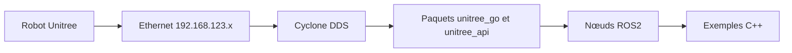

# unitreerobotics/unitree_ros2

> ROS2 packages to control Unitree Go2, B2, H1 and G1 robots over DDS, aimed at roboticists.

## The problem
Communicating with Unitree robots from ROS2 without going through an intermediate SDK layer.

## What it actually does
Provides the `unitree_go` and `unitree_api` messages on top of Cyclone DDS, which ROS2 also uses. It can read the sport mode state, the low-level state (motors, battery), the remote controller, and send walking or motor commands. C++ examples are provided, along with a lidar visualization in rviz.

## How it is wired
Simplified diagram based on the note, no diagram provided.


## Trying it
```bash
git clone https://github.com/unitreerobotics/unitree_ros2
source /opt/ros/foxy/setup.bash
colcon build
source ~/unitree_ros2/setup.sh
ros2 topic list
```

## Cost and gotchas
Free, but you need a Unitree robot (or the `lo` loopback to simulate), Ubuntu 20.04 or 22.04 and ROS2 foxy or humble. On foxy, Cyclone DDS 0.10.x has to be compiled by hand. The network interface must be set in `setup.sh`.

## What it is not
Not a robot simulator. Low-level control sends torques to the motors: real hardware risk. The messages are documented in the README, with no explanation of the algorithms.

## Alternatives
No alternative named in the README (it points to the unitree_sdk2 repository).

## For you
Ignore unless you have a Unitree robotics project: no direct link to data or MLOps.
