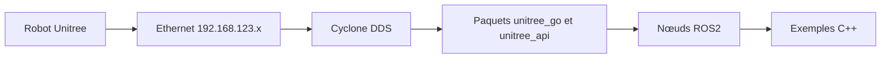

# unitreerobotics/unitree_ros2

> Paquets ROS2 pour piloter les robots Unitree Go2, B2, H1 et G1 via DDS, destinés aux roboticiens.

## Le problème
Communiquer avec les robots Unitree depuis ROS2 sans passer par une couche SDK intermédiaire.

## Ce que ça fait vraiment
Fournit les messages `unitree_go` et `unitree_api` au-dessus de Cyclone DDS, que ROS2 emploie aussi. Permet de lire l'état du mode sport, l'état bas niveau (moteurs, batterie), la télécommande, et d'envoyer des commandes de marche ou de moteurs. Des exemples C++ sont fournis, ainsi qu'une visualisation du lidar dans rviz.

## Comment c'est branché
Schéma simplifié d'après la fiche, sans diagramme fourni.


## Essayer
```bash
git clone https://github.com/unitreerobotics/unitree_ros2
source /opt/ros/foxy/setup.bash
colcon build
source ~/unitree_ros2/setup.sh
ros2 topic list
```

## Coût et pièges
Gratuit, mais il faut un robot Unitree (ou la boucle locale `lo` pour simuler), Ubuntu 20.04 ou 22.04 et ROS2 foxy ou humble. Sous foxy, Cyclone DDS 0.10.x se compile à la main. L'interface réseau doit être réglée dans `setup.sh`.

## Ce que ce n'est pas
Pas un simulateur de robot. Le contrôle bas niveau envoie des couples aux moteurs : risque matériel réel. Les messages sont documentés dans le README, pas expliqués côté algorithmes.

## Alternatives
Aucune alternative nommée dans le README (il renvoie au dépôt unitree_sdk2).

## Pour toi
À ignorer sauf projet de robotique Unitree : sans lien direct avec la data ou le MLOps.

