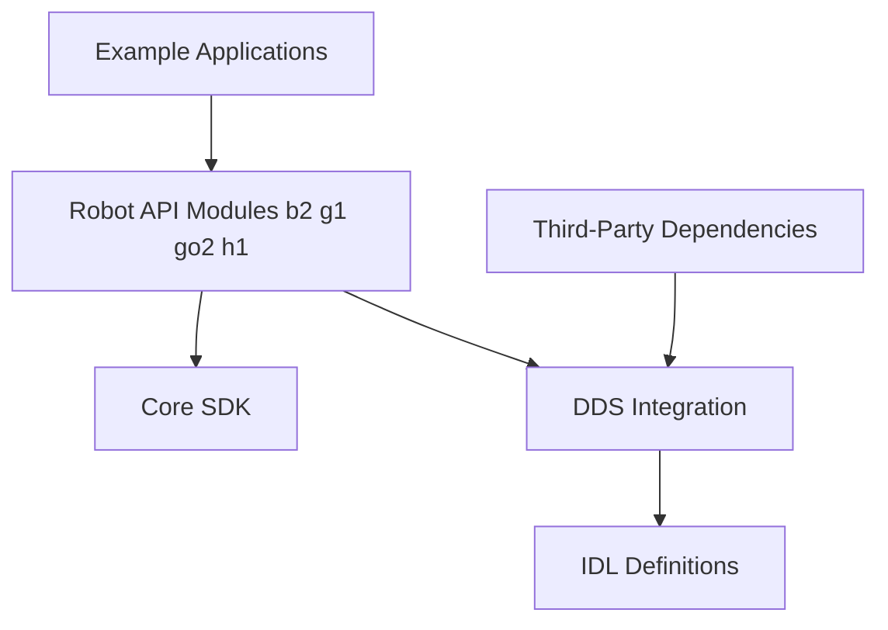

# unitreerobotics/unitree_sdk2

> Unitree's C++ SDK for controlling its robots (B2, G1, Go2, H1) via DDS.

## The problem
Controlling a Unitree robot from your own code requires a client API and a communication layer.

## What it actually does
Provides C++ headers and libraries for the robot families, a DDS integration with IDL definitions, utilities (threads, logs, time) and examples. Targets Ubuntu 20.04, aarch64 and x86_64, gcc 9.4.0, CMake 3.10+. System-wide install or into a chosen prefix.

## How it is wired


## Trying it
```bash
apt-get install -y cmake g++ build-essential libyaml-cpp-dev libeigen3-dev libboost-all-dev libfmt-dev
mkdir build
cd build
cmake ..
make
```

## Cost and gotchas
Free, but you need a Unitree robot to test. Official environment limited to Ubuntu 20.04.

## What it is not
Not a simulator nor an AI tool: it is a hardware control layer. Detailed documentation lives elsewhere (Unitree Document Center).

## Alternatives
No alternative named in the README.

## For you
Keep an eye on it: only useful if you do learning-based robotics on Unitree hardware.
