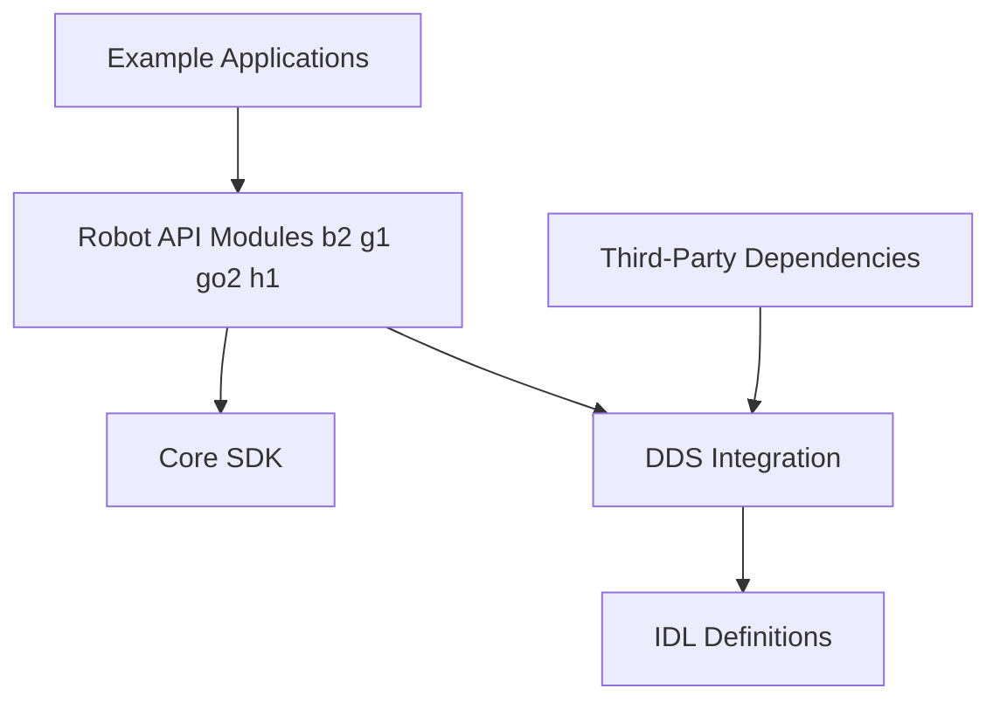

# unitreerobotics/unitree_sdk2

> SDK C++ de Unitree pour piloter ses robots (B2, G1, Go2, H1) via DDS.

## Le problème
Contrôler un robot Unitree depuis son propre code demande une API client et une couche de communication.

## Ce que ça fait vraiment
Fournit des en-têtes et bibliothèques C++ pour les familles de robots, une intégration DDS avec définitions IDL, des utilitaires (threads, logs, temps) et des exemples. Cibles Ubuntu 20.04, aarch64 et x86_64, gcc 9.4.0, CMake 3.10+. Installation système ou dans un préfixe choisi.

## Comment c'est branché


## Essayer
```bash
apt-get install -y cmake g++ build-essential libyaml-cpp-dev libeigen3-dev libboost-all-dev libfmt-dev
mkdir build
cd build
cmake ..
make
```

## Coût et pièges
Gratuit, mais il faut un robot Unitree pour tester. Environnement officiel limité à Ubuntu 20.04.

## Ce que ce n'est pas
Pas un simulateur ni un outil d'IA : c'est une couche de contrôle matériel. La documentation détaillée est ailleurs (Unitree Document Center).

## Alternatives
Aucune alternative nommée dans le README.

## Pour toi
À surveiller : utile seulement si tu fais de la robotique d'apprentissage sur du matériel Unitree.

