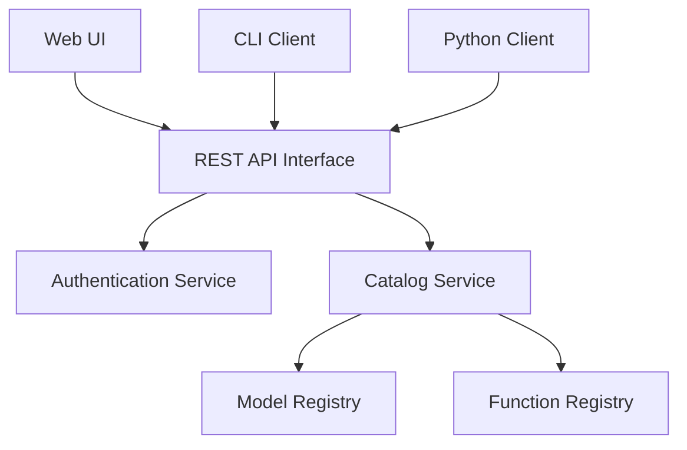

# unitycatalog/unitycatalog

> Open catalog of data and AI assets (tables, files, functions, models), for data and AI teams.

## The problem
Tables, volumes, functions and models are spread across engines and formats, with no common entry point to govern them.

## What it actually does
Java server with an OpenAPI REST API, compatible with the Hive metastore API and the Iceberg REST catalog. Handles Delta, Iceberg and Hudi (UniForm), Parquet, JSON, CSV. Provides a `bin/uc` CLI, a web interface and a Python client, plus AI integrations (LangChain, LlamaIndex, CrewAI, OpenAI, Anthropic). Sandbox project of the LF AI & Data Foundation.

## How it is wired


## Trying it
```bash
build/sbt package
bin/start-uc-server
bin/uc table list --catalog unity --schema default
bin/uc table read --full_name unity.default.numbers
```

## Cost and gotchas
Free. Requires JDK 17 and sbt; the web interface requires Node and Bun. Docker is possible via `docker compose up`.

## What it is not
Not a stable product: the README says the APIs are evolving and not stable. Not a compute engine: it only catalogs. The provided diagram is a general description, not a precise survey of the code.

## Alternatives
No alternative named in the README.

## For you
Adopt on a trial basis: an open catalog for data and models directly serves a data / AI / MLOps profile, with the caveat of still-shifting APIs.
