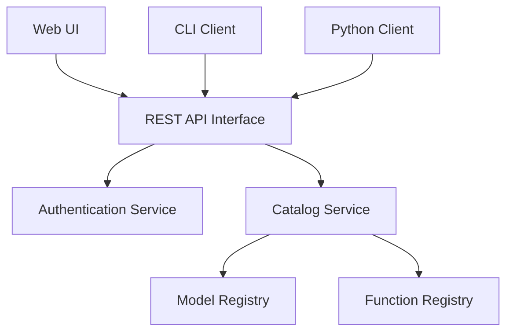

# unitycatalog/unitycatalog

> Catalogue ouvert de données et d'actifs IA (tables, fichiers, fonctions, modèles), pour équipes data et IA.

## Le problème
Les tables, volumes, fonctions et modèles sont répartis entre moteurs et formats, sans point d'entrée commun pour les gouverner.

## Ce que ça fait vraiment
Serveur Java avec API REST OpenAPI, compatible avec l'API metastore de Hive et le catalogue REST d'Iceberg. Gère Delta, Iceberg et Hudi (UniForm), Parquet, JSON, CSV. Fournit une CLI `bin/uc`, une interface web et un client Python, plus des intégrations IA (LangChain, LlamaIndex, CrewAI, OpenAI, Anthropic). Projet bac à sable de la LF AI & Data Foundation.

## Comment c'est branché


## Essayer
```bash
build/sbt package
bin/start-uc-server
bin/uc table list --catalog unity --schema default
bin/uc table read --full_name unity.default.numbers
```

## Coût et pièges
Gratuit. Demande JDK 17 et sbt ; l'interface web demande Node et Bun. Docker possible via `docker compose up`.

## Ce que ce n'est pas
Pas un produit stable : le README dit que les API évoluent et ne sont pas stables. Pas un moteur de calcul : il cataloge seulement. Le diagramme fourni est une description générale, non un relevé précis du code.

## Alternatives
Aucune alternative nommée dans le README.

## Pour toi
À adopter à l'essai : un catalogue ouvert pour données et modèles sert directement un profil data / IA / MLOps, avec la réserve d'API encore mouvantes.

