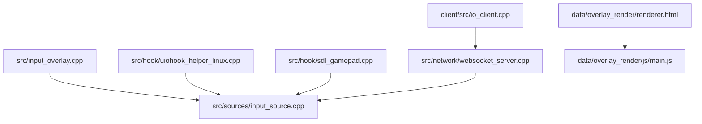

# univrsal/input-overlay

> OBS Studio plugin that displays keyboard, mouse and gamepad on screen during a stream.

## The problem
Viewers cannot see which keys are pressed during a demo or a stream.

## What it actually does
OBS plugin for 64-bit Windows and Linux. An input source receives keyboard and mouse events via libuiohook and gamepads via SDL. A remote client can send them over WebSocket, and `renderer.html` displays them in a browser. The README is very short: the details are in the wiki.

## How it is wired
Diagram based on the supplied diagram.

## Trying it
No command documented in this README: binaries are in the releases, installation is described in the wiki.

## Cost and gotchas
Free. OBS Studio required (not listed among the possible prerequisites). Depends on libuiohook (GPL-3.0), mongoose (GPL-2.0) and SDL2 (zlib): copyleft license.

## What it is not
Not a keylogger: according to the README, it displays inputs during a stream. Not for macOS.

## Alternatives
No alternative named in the README.

## For you
Ignore: only useful for streaming demos or tutorials with key display, which remains secondary for your work.
