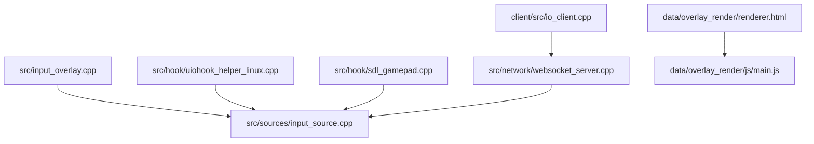

# univrsal/input-overlay

> Plugin OBS Studio qui affiche clavier, souris et manette à l'écran pendant un stream.

## Le problème
Les spectateurs ne voient pas les touches pressées pendant une démonstration ou un stream.

## Ce que ça fait vraiment
Plugin OBS pour Windows et Linux 64 bits. Une source d'entrée reçoit les événements clavier et souris via libuiohook et les manettes via SDL. Un client distant peut les envoyer par WebSocket, et `renderer.html` les affiche dans un navigateur. Le README est très court : le détail est dans le wiki.

## Comment c'est branché
Schéma d'après le diagramme fourni.

## Essayer
Aucune commande documentée dans ce README : les binaires sont dans les releases, l'installation est décrite dans le wiki.

## Coût et pièges
Gratuit. OBS Studio requis (non listé dans les prérequis possibles). Dépend de libuiohook (GPL-3.0), mongoose (GPL-2.0) et SDL2 (zlib) : licence copyleft.

## Ce que ce n'est pas
Pas un enregistreur de frappes : il affiche, selon le README, les entrées pendant un stream. Pas pour macOS.

## Alternatives
Aucune alternative nommée dans le README.

## Pour toi
À ignorer : utile seulement pour streamer des démos ou tutoriels avec affichage des touches, ce qui reste secondaire pour ton travail.

