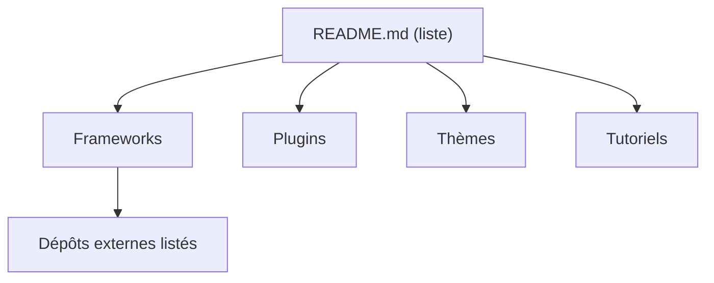

# unixorn/awesome-zsh-plugins

> Annotated list of ZSH frameworks, plugin managers, themes and tutorials, for anyone customizing their shell.

## The problem
There are dozens of ZSH plugin managers and it is hard to know which ones to compare. The README also warns that entries are not audited.

## What it actually does
A README structured in sections (Frameworks, plugins, themes, tutorials). Each entry takes one to a few lines: oh-my-zsh, prezto, zinit, antidote, sheldon, zplug, zgenom, znap, etc. No code to run: it is an index. The README provided is truncated after the frameworks.

## How it is wired


## Trying it
```bash
# Aucune commande documentée : ouvrir le README et suivre le lien du gestionnaire retenu.
```

## Cost and gotchas
Free. The README declares a BSD-3-Clause license and warns: use "at your own risk", the maintainer does not read the code of every entry.

## What it is not
Not a tool and nothing here gets installed. Not a ranking: entries are described in their authors' own words. The security of the listed plugins is not verified.

## Alternatives
- oh-my-zsh: the most widespread framework, more than 120 plugins and themes included.
- zinit: manager focused on startup speed (Turbo mode).
- antidote: manager designed for performance, generates a static plugins file.

## For you
Worth watching: useful for choosing a ZSH plugin manager, with no direct link to data/AI/MLOps work.
