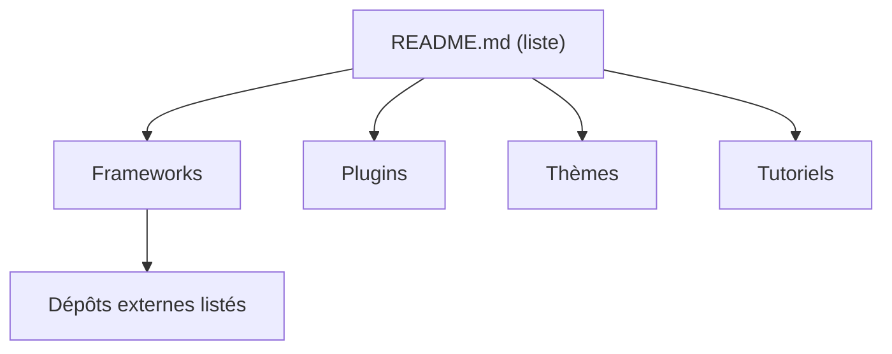

# unixorn/awesome-zsh-plugins

> Liste commentée de frameworks, gestionnaires de plugins, thèmes et tutoriels ZSH, pour qui personnalise son shell.

## Le problème
Il existe des dizaines de gestionnaires de plugins ZSH et on ne sait pas lesquels comparer. Le README prévient aussi que les entrées ne sont pas auditées.

## Ce que ça fait vraiment
Un README structuré en sections (Frameworks, plugins, thèmes, tutoriels). Chaque entrée tient en une à quelques lignes : oh-my-zsh, prezto, zinit, antidote, sheldon, zplug, zgenom, znap, etc. Aucun code à exécuter : c'est un index. Le README fourni est tronqué après les frameworks.

## Comment c'est branché


## Essayer
```bash
# Aucune commande documentée : ouvrir le README et suivre le lien du gestionnaire retenu.
```

## Coût et pièges
Gratuit. Le README déclare une licence BSD-3-Clause et avertit : à utiliser « at your own risk », le mainteneur ne lit pas le code de chaque entrée.

## Ce que ce n'est pas
Ce n'est pas un outil et rien ici ne s'installe. Ce n'est pas un classement : les entrées sont décrites avec les mots de leurs auteurs. La sécurité des plugins listés n'est pas vérifiée.

## Alternatives
- oh-my-zsh : framework le plus répandu, plus de 120 plugins et thèmes inclus.
- zinit : gestionnaire orienté vitesse de démarrage (mode Turbo).
- antidote : gestionnaire pensé performance, génère un fichier de plugins statique.

## Pour toi
Surveiller : utile pour choisir un gestionnaire de plugins ZSH, sans lien direct avec le travail data/IA/MLOps.

