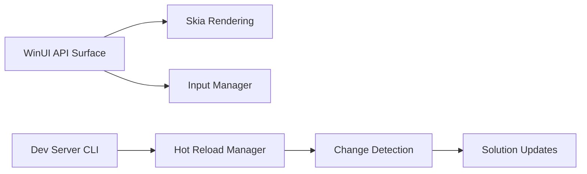

# unoplatform/uno

> Single-codebase .NET C#/XAML framework targeting web, desktop, mobile and embedded, for application developers.

## The problem
Maintaining one codebase per platform for the same .NET application.

## What it actually does
Reuses the WinUI 3 API and renders the UI via Skia (unified rendering) or native controls. Targets: Windows, macOS, Linux, iOS, Android, WebAssembly. Hot Reload and a dev server CLI with an MCP proxy. A paid suite, Uno Platform Studio, adds an AI agent and visual design.

## How it is wired

## Trying it
The README gives no specific command: it points to the Uno.Check tool and the IDE's project creation wizard.

## Cost and gotchas
Free core (Apache-2.0); Studio (agent, Hot Design) is presented as a separate suite. Heavy .NET toolchain. 2,148 open issues.

## What it is not
Not a data/AI tool. Not all Studio features are in the free core.

## Alternatives
- .NET MAUI: cited in the README, its controls can be used in Uno.

## For you
Ignore: this is cross-platform .NET UI development, outside your data / AI / MLOps scope.
