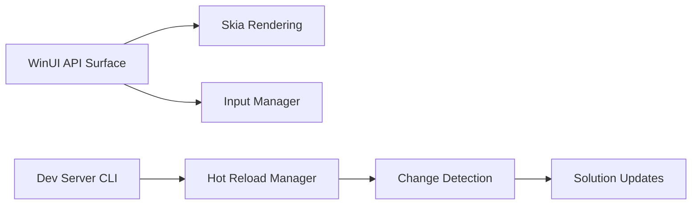

# unoplatform/uno

> Framework .NET C#/XAML mono-code vers web, desktop, mobile et embarqué, pour développeurs d'applications.

## Le problème
Maintenir une base de code par plateforme pour une même application .NET.

## Ce que ça fait vraiment
Reprend l'API WinUI 3 et rend l'UI via Skia (rendu unifié) ou en contrôles natifs. Cibles : Windows, macOS, Linux, iOS, Android, WebAssembly. Hot Reload et CLI de dev server avec proxy MCP. Une suite payante, Uno Platform Studio, ajoute agent IA et design visuel.

## Comment c'est branché

## Essayer
Le README ne donne pas de commande précise : il renvoie à l'outil Uno.Check et à l'assistant de création de projet de l'IDE.

## Coût et pièges
Cœur gratuit (Apache-2.0) ; Studio (agent, Hot Design) est présenté comme suite à part. Toolchain .NET lourde. 2 148 issues ouvertes.

## Ce que ce n'est pas
Pas un outil data/IA. Les fonctions Studio ne sont pas toutes dans le cœur libre.

## Alternatives
- .NET MAUI : cité dans le README, ses contrôles sont utilisables dans Uno.

## Pour toi
À ignorer : c'est du développement d'UI .NET multiplateforme, hors de ton périmètre data / IA / MLOps.

