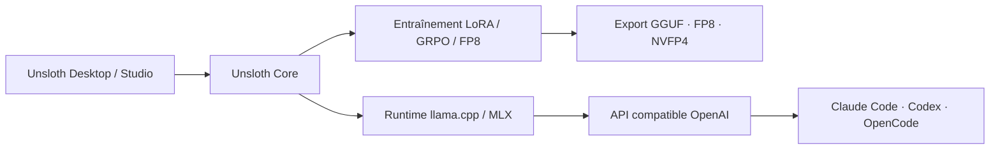

# unslothai/unsloth

> Desktop application and library for running and training large language models (LLMs) locally.

## The problem
Fine-tuning a large language model requires a fragile CUDA stack, a significant amount of VRAM, and code to train the model. Running a local model for a code agent still requires manual setup.

## What it actually does
Three forms: a desktop application (Windows/macOS/Linux), a WebUI called "Unsloth Studio", and "Unsloth Core", the Python library. LoRA, QLoRA, full fine-tuning, GRPO, DPO, FP8 training; export GGUF, NVFP4, FP8. Serves models via an OpenAI-compatible API. `unsloth start claude` connects Claude Code, Codex, or OpenCode to a local model. Supports NVIDIA, AMD (separate ROCm support), Intel, CPUs, and Vulkan.

## How it is wired


## Trying it
```bash
curl -fsSL https://unsloth.ai/install.sh | sh
unsloth studio
unsloth start claude --model unsloth/Qwen3.8-27B-GGUF:UD-Q4_K_XL
```

## Cost and gotchas
GPU and VRAM are your responsibility. The server tools are **enabled by default**: exposing Studio without `--disable-tools` or a strong password is risky. The Docker ports publish on all interfaces.

## What it is not
This is not a hosted service: everything runs on your own infrastructure, with the corresponding hardware costs. It is not a replacement for vLLM in a multi-user production environment. The ROCm/WSL2 approach requires a build specific to each architecture.

## Alternatives
- llama.cpp: the underlying execution engine, if you only need to perform inference.
- Transformers / TRL from Hugging Face: Training without extra layers.

## For you
This is the recommended approach if you are fine-tuning on your own machine; it's the most direct way to get a dataset and a GGUF model ready.
