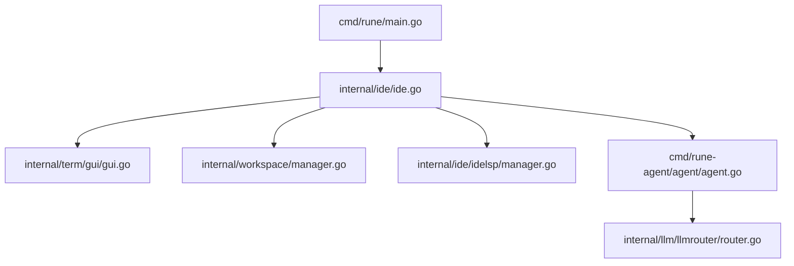

# unstablebuild/rune

> Native Go IDE and terminal multiplexer, GPU-accelerated, with a built-in coding agent.

## The problem
Electron IDEs are heavy and combine terminals, editor and remote work across several machines poorly.

## What it actually does
Rune displays editor, terminals and workspaces through OpenGL (Linux) or Metal (macOS). It drives language servers through extensions, opens remote workspaces over SSH or on its encrypted peer network, and hosts a coding agent that talks to Anthropic, OpenAI, Gemini, Bedrock, Ollama or llama.cpp. A headless mode serves a workspace from Docker.

## How it is wired


## Trying it
```bash
curl -fsSL https://rune.build/install.sh | sh
brew install unstablebuild/tap/rune
go run ./cmd/rune
```

## Cost and gotchas
Free for the binary, GPL-3.0; the agent's models remain at your expense depending on the provider. Linux and macOS only. Based on the architecture, telemetry and crash-report APIs are optional; the terms are not in the README.

## What it is not
It is not an Electron editor nor a hosted service. The repository dates from September 2026 with 117 open issues: the project is new.

## Alternatives
No alternative named in the README.

## For you
Keep an eye on it: a native IDE with a multi-model agent and encrypted remote workspaces is of interest to an AI profile, but too young to replace your editor.
