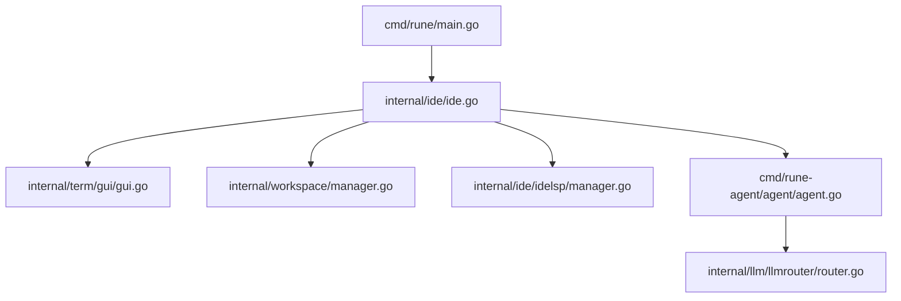

# unstablebuild/rune

> IDE et multiplexeur de terminaux natif en Go, accéléré par GPU, avec agent de code intégré.

## Le problème
Les IDE Electron sont lourds et mélangent mal terminaux, éditeur et travail à distance sur plusieurs machines.

## Ce que ça fait vraiment
Rune affiche éditeur, terminaux et espaces de travail via OpenGL (Linux) ou Metal (macOS). Il pilote des serveurs de langage par extensions, ouvre des espaces distants en SSH ou sur son réseau chiffré de pairs, et héberge un agent de code qui parle à Anthropic, OpenAI, Gemini, Bedrock, Ollama ou llama.cpp. Un mode headless sert un espace de travail depuis Docker.

## Comment c'est branché


## Essayer
```bash
curl -fsSL https://rune.build/install.sh | sh
brew install unstablebuild/tap/rune
go run ./cmd/rune
```

## Coût et pièges
Gratuit pour le binaire, GPL-3.0 ; les modèles de l'agent restent à ta charge selon le fournisseur. Linux et macOS seulement. D'après l'architecture, des API de télémétrie et de rapport de plantage sont optionnelles ; les modalités ne sont pas dans le README.

## Ce que ce n'est pas
Ce n'est pas un éditeur Electron ni un service hébergé. Le dépôt date de septembre 2026 avec 117 issues ouvertes : le projet est neuf.

## Alternatives
Aucune alternative nommée dans le README.

## Pour toi
À surveiller : un IDE natif avec agent multi-modèles et espaces distants chiffrés intéresse un profil IA, mais trop jeune pour remplacer ton éditeur.

