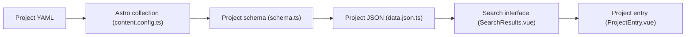

# up-for-grabs/up-for-grabs.net

> Source of the Up For Grabs site, a directory of open source projects with tasks for new contributors.

## The problem
Beginners do not know where to find open projects with small, accessible tasks.

## What it actually does
Contains the YAML files describing the listed projects and the site that displays them. The beta version (Astro + Vue) loads and validates the YAML, exposes a JSON at build time, then the browser filters by text and recent activity; an old JavaScript listing remains with URL filters and pagination. Proposing a project is done by pull request.

## How it is wired


## Trying it
```bash
npm install
npm run dev
npm run build
npm run preview
```

## Cost and gotchas
Free. The license is "present but unidentified" according to GitHub: check it before reusing the code.

## What it is not
Not a contributor/project matching engine: it is a hand-curated catalog, with projects that may be inactive.

## Alternatives
No alternative named in the README.

## For you
Ignore: useful for finding a first project to contribute to, but not a tool for your daily data/MLOps work.
