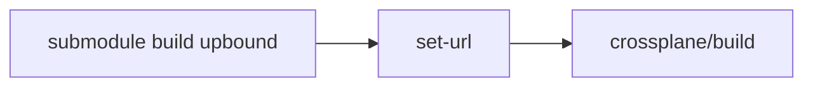

# upbound/build

> Dépôt de build archivé pour providers Crossplane, remplacé par crossplane/build.

## Le problème
Fournir un socle de build partagé aux providers Crossplane.

## Ce que ça fait vraiment
Le README ne décrit que sa fin de vie : le dépôt n'est plus maintenu et il faut passer à crossplane/build en changeant l'URL du sous-module. Le contenu du build n'est pas décrit : non documenté.

## Comment c'est branché


## Essayer
```bash
git submodule set-url -- build https://github.com/crossplane/build
git submodule sync
cd build
git checkout main
git pull
```

## Coût et pièges
Archivé, dernier push en 2024. Ne pas l'adopter.

## Ce que ce n'est pas
Plus maintenu : ce n'est pas une base à utiliser pour un nouveau projet.

## Alternatives
- crossplane/build, recommandé par le README.

## Pour toi
Ignorer : archivé et remplacé par crossplane/build.

