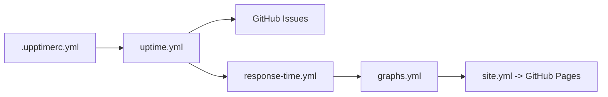

# upptime/upptime

> Uptime monitor and status page that run entirely on GitHub Actions, Issues and Pages.

## The problem
A paid uptime service or a dedicated server just to monitor a few URLs.

## What it actually does
A scheduled workflow (every 5 minutes) tests the endpoints; the response time is committed to git (four times a day according to the Concepts section); an incident opens a GitHub issue, closed when the site comes back; a Svelte status page is served by GitHub Pages. Configuration lives in `.upptimerc.yml`. Slack notifications.

## How it is wired

## Trying it
No command in the README: getting started goes through the online documentation ("Getting started").

## Cost and gotchas
Free if you are on GitHub, but depends on its Actions quotas. The data lives in the repository: deleting the repository deletes it.

## What it is not
Not independent of GitHub; not affiliated with or endorsed by GitHub. Granularity is limited to the cron cadence.

## Alternatives
No alternative named.

## For you
Keep an eye on it: handy for monitoring a model or API endpoint without infrastructure, as long as the dependency on GitHub suits you.
