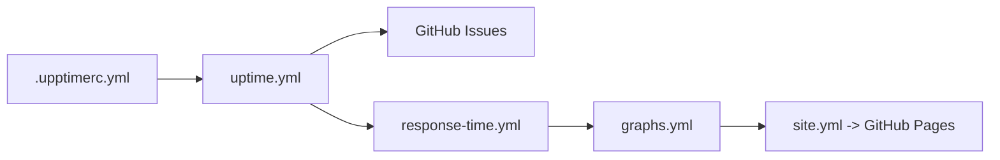

# upptime/upptime

> Moniteur de disponibilité et page de statut qui tournent entièrement sur GitHub Actions, Issues et Pages.

## Le problème
Un service d'uptime payant ou un serveur dédié pour surveiller quelques URL.

## Ce que ça fait vraiment
Un workflow planifié (toutes les 5 minutes) teste les endpoints ; le temps de réponse est committé dans git (quatre fois par jour d'après la section Concepts) ; un incident ouvre une issue GitHub, fermée au retour du site ; une page de statut Svelte est servie par GitHub Pages. Config dans `.upptimerc.yml`. Notifications Slack.

## Comment c'est branché

## Essayer
Aucune commande dans le README : démarrage via la documentation en ligne (« Getting started »).

## Coût et pièges
Gratuit si tu es sur GitHub, mais dépend de ses quotas Actions. Les données vivent dans le dépôt : supprimer le dépôt les supprime.

## Ce que ce n'est pas
Pas indépendant de GitHub ; non affilié ni soutenu par GitHub. Granularité limitée à la cadence du cron.

## Alternatives
Aucune alternative nommée.

## Pour toi
Surveiller : pratique pour monitorer un endpoint de modèle ou d'API sans infra, tant que la dépendance à GitHub te convient.

