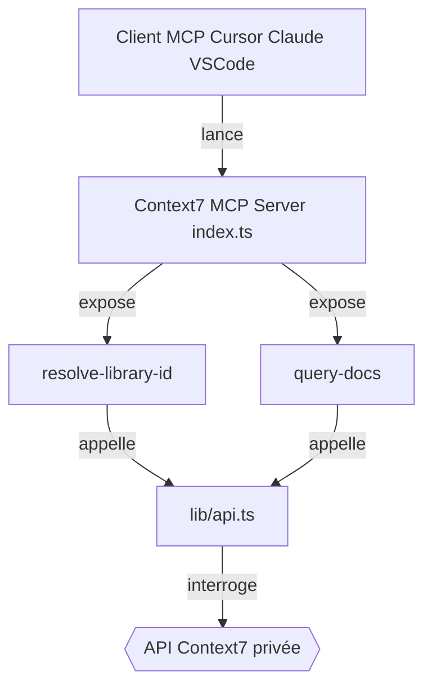

# upstash/context7

> MCP server and CLI that inject up-to-date library documentation into your coding agent.

## The problem
LLMs suggest outdated or invented APIs, based on year-old training data, and ignore the version of the library in use.

## What it actually does
Two MCP tools: `resolve-library-id` (library name to identifier) and `query-docs` (documentation and examples for a question). The same exists as the `ctx7` CLI with a skill. You add "use context7" to the prompt, or the identifier `/supabase/supabase`, and the version is inferred from the text. The repository contains only the MCP server; the backend, indexing and crawling are private.

## How it is wired


## Trying it
```bash
npx ctx7 setup
# retirer la configuration
npx ctx7 remove
```

## Cost and gotchas
Node.js 22.13 or later for the CLI. A free API key is recommended for better rate limits. Indexed documents are community-provided: accuracy and security are not guaranteed.

## What it is not
Not a fully open-source engine: the part that collects and ranks documentation is private and hosted by Upstash. It does not work offline.

## Alternatives
No alternative named in the README.

## For you
Adopt it to reduce hallucinated APIs in your coding agent, accepting the dependency on a hosted service.
