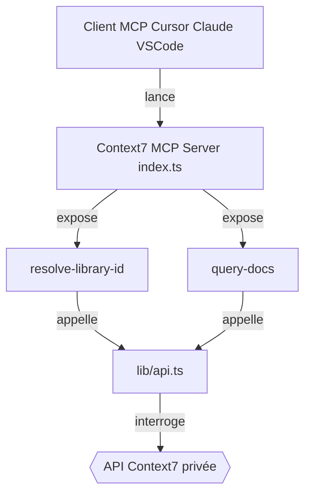

# upstash/context7

> Serveur MCP et CLI qui injectent dans votre agent de code la documentation à jour des bibliothèques.

## Le problème
Les LLM suggèrent des API périmées ou inventées, calées sur des données d'entraînement vieilles d'un an, et ignorent la version de la bibliothèque utilisée.

## Ce que ça fait vraiment
Deux outils MCP : `resolve-library-id` (nom de bibliothèque vers identifiant) et `query-docs` (documentation et exemples pour une question). La même chose existe en CLI `ctx7` avec un skill. On ajoute « use context7 » au prompt, ou l'identifiant `/supabase/supabase`, et la version se déduit du texte. Le dépôt ne contient que le serveur MCP ; le backend, l'indexation et le crawl sont privés.

## Comment c'est branché


## Essayer
```bash
npx ctx7 setup
# retirer la configuration
npx ctx7 remove
```

## Coût et pièges
Node.js 22.13 ou plus pour la CLI. Une clé d'API gratuite est recommandée pour de meilleures limites de débit. Les documents indexés sont fournis par la communauté : exactitude et sécurité ne sont pas garanties.

## Ce que ce n'est pas
Ce n'est pas un moteur open source complet : la partie qui collecte et classe la documentation est privée et hébergée par Upstash. Il ne fonctionne pas hors ligne.

## Alternatives
Aucune alternative nommée dans le README.

## Pour toi
À adopter pour réduire les API hallucinées dans ton agent de code, en acceptant la dépendance à un service hébergé.

