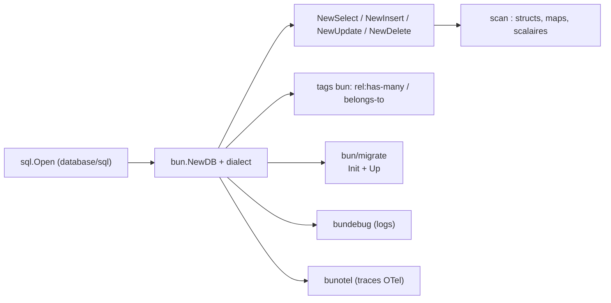

# uptrace/bun

> SQL-first Go ORM for PostgreSQL, MySQL, MSSQL, SQLite and Oracle.

## The problem
Go ORMs hide the SQL and make complex queries unreadable; writing raw `database/sql` loses typing, result scanning and portability across engines.

## What it actually does
Builds queries in Go with an API that follows the shape of SQL (`NewSelect`, `ColumnExpr`, `TableExpr`, `With` for CTEs), and scans results into structs, maps, scalars or individual variables. Relations (`has-many`, `has-one`, `belongs-to`) are declared with struct tags and loaded with `Relation()`. Provides bulk inserts, updates and deletes, a versioned migration system (`migrate.NewMigrations`, `migrator.Up`), fixtures, soft deletes, a verbose logging hook (`bundebug`) and an OpenTelemetry hook (`bunotel`). Built on top of `database/sql`.

## How it is wired


## Trying it
```bash
go get github.com/uptrace/bun
```

## Cost and gotchas
Free, no service dependency. The driver and dialect must match the engine (`sqlitedialect` + `sqliteshim` for SQLite, etc.). The README pushes the author's own Uptrace APM: the OTel integration is real, the product behind it is commercial.

## What it is not
Not a schema generator from the database: models are written by hand in Go. Not an ORM that spares you from knowing SQL — it is the opposite by design. The README examples ignore returned errors (`db.NewInsert().Model(user).Exec(ctx)` with no check), so this is not code to copy.

## Alternatives
No competing ORM is named: the README only cites the author's sibling projects (HTTP router, msgpack) and Uptrace.

## For you
Out of scope: nothing for a data / AI / MLOps profile, unless you maintain a Go service.
