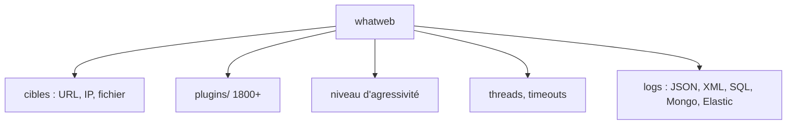

# urbanadventurer/WhatWeb

> Command-line scanner that identifies the technologies of a website, for security and inventory.

## The problem
Knowing which CMS, server, framework or JavaScript library runs a site, without inspecting it by hand.

## What it actually does
- Recognizes technologies via more than 1800 plugins (strings, regexes, MD5 hashes, HTML patterns, Ruby code).
- Also detects versions, e-mails, account identifiers, SQL errors.
- Aggression level from 1 (one request per target, default) to 4 (many requests).
- Multiple outputs: brief, verbose, XML, JSON, SQL, MongoDB, Elasticsearch.

## How it is wired


## Trying it
```bash
./whatweb reddit.com
./whatweb -v reddit.com slashdot.org
./whatweb -a 3 www.wired.com
./whatweb -l
./whatweb --log-json=results.json targets.txt
```

## Cost and gotchas
Free, Ruby installation (bundle); the README does not detail the basic installation. Levels 3 and 4 generate additional requests.

## What it is not
Not an exploitation tool: the README states that no penetration testing is handled. Only scan public or authorized targets; the aggressive levels are intended for penetration tests with permission. GPL-2.0 (copyleft).

## Alternatives
- No alternative named in the README (it mentions massscan as a complement for discovering open ports).

## For you
Worth watching: useful for inventorying your own exposed services; without a security concern, it brings nothing to a data/AI/MLOps profile.
