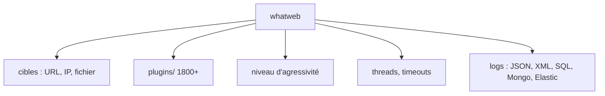

# urbanadventurer/WhatWeb

> Scanner en ligne de commande qui identifie les technologies d'un site web, pour sécurité et inventaire.

## Le problème
Savoir quel CMS, serveur, framework ou bibliothèque JavaScript fait tourner un site, sans l'inspecter à la main.

## Ce que ça fait vraiment
- Reconnaît les technologies via plus de 1800 plugins (chaînes, regex, hashes MD5, motifs HTML, code Ruby).
- Détecte aussi versions, e-mails, identifiants de comptes, erreurs SQL.
- Niveau d'agressivité de 1 (une requête par cible, défaut) à 4 (nombreuses requêtes).
- Sorties multiples : brief, verbose, XML, JSON, SQL, MongoDB, Elasticsearch.

## Comment c'est branché


## Essayer
```bash
./whatweb reddit.com
./whatweb -v reddit.com slashdot.org
./whatweb -a 3 www.wired.com
./whatweb -l
./whatweb --log-json=results.json targets.txt
```

## Coût et pièges
Gratuit, installation Ruby (bundle) ; le README ne détaille pas l'installation de base. Les niveaux 3 et 4 génèrent des requêtes supplémentaires.

## Ce que ce n'est pas
Pas un outil d'exploitation : le README précise qu'aucun test d'intrusion n'est géré. Ne scanner que des cibles publiques ou autorisées ; les niveaux agressifs sont prévus pour des tests d'intrusion avec permission. GPL-2.0 (copyleft).

## Alternatives
- Aucune alternative nommée dans le README (il cite massscan comme complément pour découvrir les ports ouverts).

## Pour toi
Surveiller : utile pour inventorier tes propres services exposés ; sans enjeu sécurité, il n'apporte rien à un profil data/IA/MLOps.

