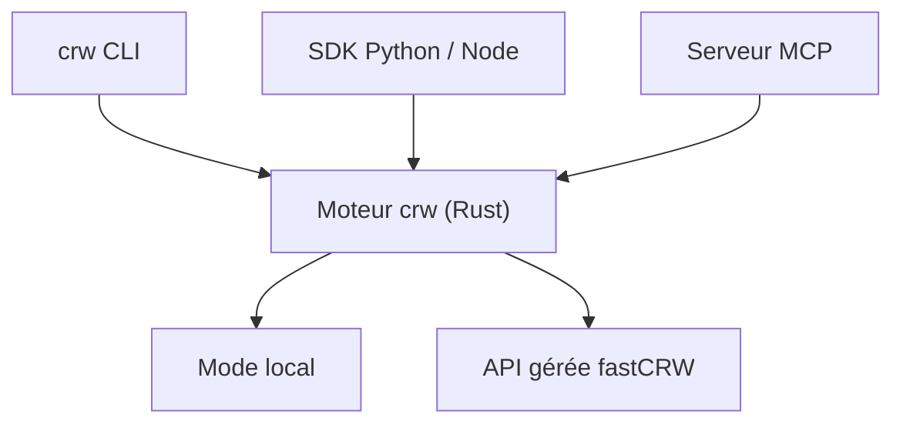

# us/crw

> Rust engine that turns URLs into markdown or structured JSON, locally or through a managed API.

## The problem
Agents and RAG pipelines need clean web pages, without writing a scraper for each site.

## What it actually does
A Rust binary with five operations: scrape (markdown, HTML, links, screenshots, JSON), crawl, map, search and extract. It is used through the CLI, the Python or Node SDK, REST, or as an MCP server installed in Claude Code, Cursor, Codex and other detected tools.

## How it is wired


## Trying it
```bash
curl -fsSL https://fastcrw.com/install | sh
crw https://example.com
crw search "rust async runtime"
pip install crw
npx -y crw-mcp@latest install
```

## Cost and gotchas
Local is free, with no account. The cloud gives 1000 free credits, then is paid. Installing via `curl | sh` modifies the configuration of your detected AI tools (can be disabled with `CRW_NO_AGENTS=1`).

## What it is not
Capabilities differ between local and cloud (proxies, JS rendering, search). The benchmarks cited are the vendor's own. The AGPL license requires sharing the code when offered as a network service.

## Alternatives
Firecrawl and Crawl4AI: compared in the README; Firecrawl has a migration guide.

## For you
Watch: a good candidate to feed a RAG locally, to test against your current scraper, checking the AGPL before any commercial use.
