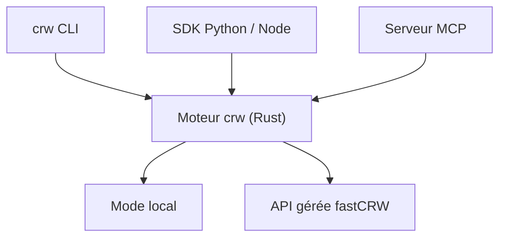

# us/crw

> Moteur Rust qui transforme des URLs en markdown ou JSON structuré, en local ou via une API gérée.

## Le problème
Les agents et pipelines RAG ont besoin de pages web propres, sans écrire un scraper par site.

## Ce que ça fait vraiment
Un binaire Rust avec cinq opérations : scrape (markdown, HTML, liens, captures, JSON), crawl, map, search et extract. Il s'utilise en CLI, en SDK Python ou Node, en REST, ou comme serveur MCP installé dans Claude Code, Cursor, Codex et autres outils détectés.

## Comment c'est branché


## Essayer
```bash
curl -fsSL https://fastcrw.com/install | sh
crw https://example.com
crw search "rust async runtime"
pip install crw
npx -y crw-mcp@latest install
```

## Coût et pièges
Local gratuit, sans compte. Le cloud donne 1000 crédits gratuits, puis payant. L'installation par `curl | sh` modifie la configuration de tes outils d'IA détectés (désactivable avec `CRW_NO_AGENTS=1`).

## Ce que ce n'est pas
Les capacités diffèrent entre local et cloud (proxies, rendu JS, recherche). Les benchmarks cités sont ceux de l'éditeur. La licence AGPL impose le partage du code en cas de service réseau.

## Alternatives
Firecrawl et Crawl4AI : comparés par le README ; Firecrawl a un guide de migration.

## Pour toi
Surveiller : bon candidat pour alimenter un RAG en local, à tester contre ton scraper actuel, en vérifiant l'AGPL avant tout usage commercial.

