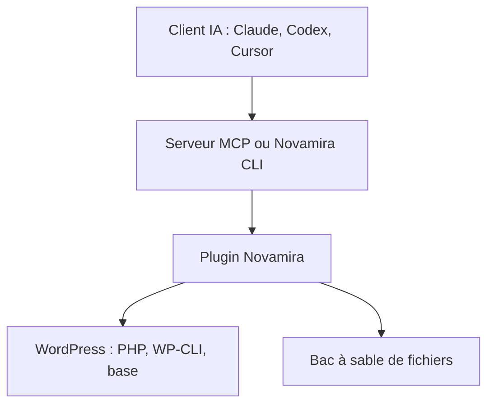

# use-novamira/novamira

> WordPress plugin and MCP server giving AI agents direct access to the site, for developers.

## The problem
An AI agent cannot act in WordPress without access to the real site's code, database and files.

## What it actually does
The plugin exposes to an MCP client PHP execution, WP-CLI, database inspection, file editing in a sandbox, editor blocks and media. Authentication goes through OAuth or application passwords. A read mode removes the abilities that modify the site; it is enabled with Novamira Pro.

## How it is wired
Simplified diagram based on the sheet, no diagram provided.

## Trying it
No command documented in the README: download the release ZIP, upload it via Plugins > Add, activate, then open Novamira > Settings.

## Cost and gotchas
Requires WordPress 6.9+, PHP 8.0+, an administrator account and HTTPS for remote use. Use the release ZIP, not the source archive. Read mode requires Novamira Pro.

## What it is not
Not a hosted proxy. The README warns: for development and staging only, with backups. Read mode is not a security feature.

## Alternatives
No alternative cited in the README.

## For you
Worth watching: a demonstration of an agent with full access to a real system, to try only on a disposable site.
