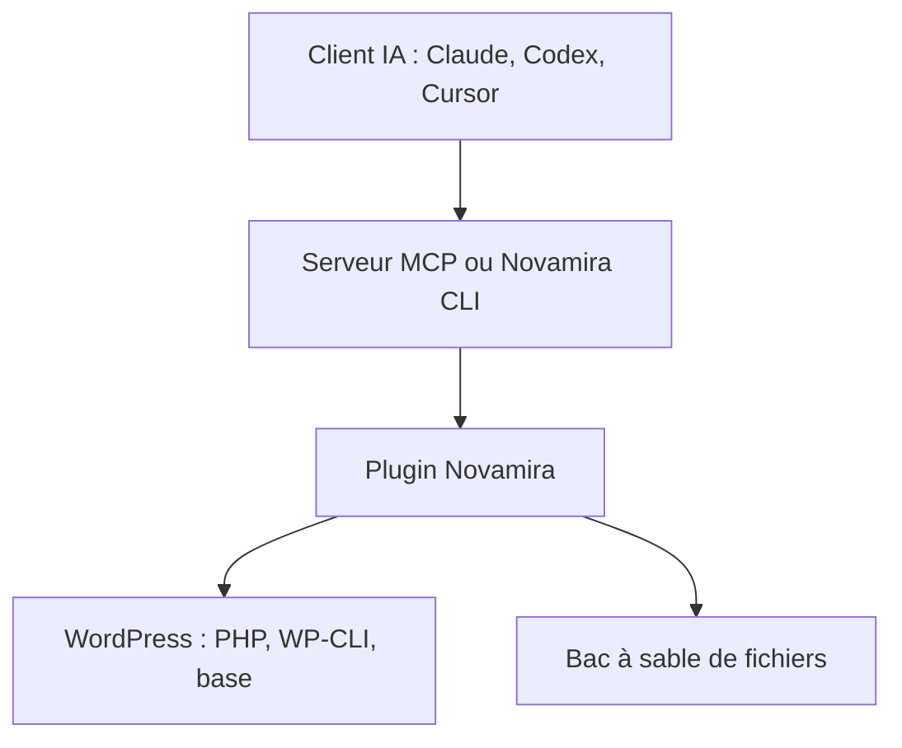

# use-novamira/novamira

> Extension WordPress et serveur MCP donnant aux agents IA un accès direct au site, pour développeurs.

## Le problème
Un agent IA ne peut pas agir dans WordPress sans accès au code, à la base et aux fichiers du site réel.

## Ce que ça fait vraiment
Le plugin expose à un client MCP l'exécution PHP, WP-CLI, l'inspection de la base, l'édition de fichiers dans un bac à sable, les blocs de l'éditeur et les médias. L'authentification passe par OAuth ou mots de passe d'application. Un mode lecture retire les abilities qui modifient le site ; il s'active avec Novamira Pro.

## Comment c'est branché
Schéma simplifié d'après la fiche, sans diagramme fourni.

## Essayer
Aucune commande documentée dans le README : télécharger le ZIP de release, l'envoyer via Extensions > Ajouter, activer, puis ouvrir Novamira > Configuration.

## Coût et pièges
Il faut WordPress 6.9+, PHP 8.0+, un compte administrateur et HTTPS en distant. Utiliser le ZIP de release, pas l'archive source. Le mode lecture demande Novamira Pro.

## Ce que ce n'est pas
Pas un proxy hébergé. Le README prévient : pour développement et préproduction, avec sauvegardes. Le mode lecture n'est pas une fonction de sécurité.

## Alternatives
Aucune alternative citée dans le README.

## Pour toi
À surveiller : démonstration d'un agent avec accès total à un système réel, à n'essayer que sur un site jetable.

