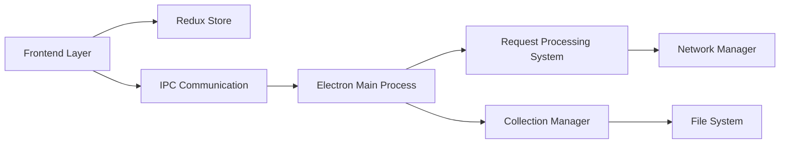

# usebruno/bruno

> Open-source offline API client whose collections are plain-text files you can version with Git.

## The problem
Conventional API clients store collections in the cloud, which complicates sharing, version control and privacy.

## What it actually does
A desktop application that saves each request as a text file in Bru format, in a folder on your disk. You collaborate with Git. A CLI (`bru`) runs collections in CI, with official Docker images. No cloud sync, "not now, not ever" according to the README.

## How it is wired

The architecture text is a partly assumed drawing guide.

## Trying it
```bash
brew install bruno
npm install -g @usebruno/cli
bru run
bru run folder --env Local
docker pull usebruno/cli:latest
docker run -v $(pwd):/bruno usebruno/cli run
```

## Cost and gotchas
The essentials are free; commercial versions add features. The "Bruno" trademark belongs to Anoop M D. Many open issues (1,851).

## What it is not
Not a cloud collaboration tool: sharing goes through Git. Nor is it a load-testing or monitoring tool.

## Alternatives
- Postman (cited as the reference to replace): prefer it if you need cloud synchronization.

## For you
Adopt: test model or MLOps API endpoints with versioned collections and CI runs via the CLI or Docker.
