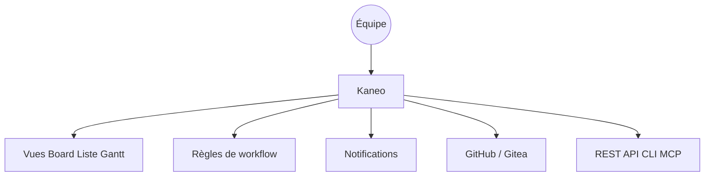

# usekaneo/kaneo

> Project management tool, cloud or self-hosted, with API, CLI and MCP.

## The problem
Project management tools become a project to maintain in themselves.

## What it actually does
Board, list, calendar and Gantt views, backlog, subtasks, dependencies, labels, time tracking, shared workspaces and custom roles. Rules that move tasks based on repository activity, notifications (email, ntfy, Gotify, webhooks) and integrations with GitHub, Gitea, REST API, command-line client and MCP.

## How it is wired

## Trying it
No command is documented in the provided README: it points to Kaneo Cloud and the self-hosting installation guide.

## Cost and gotchas
Cloud version (terms not specified) or self-hosting at your expense. The installation details are not in the README.

## What it is not
Not a data/AI tool: it is a general-purpose task manager. The MCP and the API are access points, not agents.

## Alternatives
No alternative named in the README.

## For you
Ignore unless you need a self-hosted project manager; for a data/AI profile, the interest lies in MCP access.
