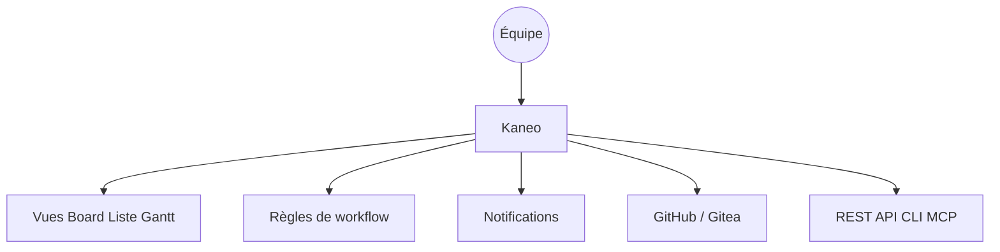

# usekaneo/kaneo

> Outil de gestion de projet en cloud ou auto-hébergé, avec API, CLI et MCP.

## Le problème
Les outils de gestion de projet deviennent eux-mêmes un projet à entretenir.

## Ce que ça fait vraiment
Vues tableau, liste, calendrier et Gantt, backlog, sous-tâches, dépendances, étiquettes, suivi du temps, espaces partagés et rôles personnalisés. Règles qui déplacent les tâches selon l'activité du dépôt, notifications (e-mail, ntfy, Gotify, webhooks) et intégrations GitHub, Gitea, API REST, client en ligne de commande et MCP.

## Comment c'est branché

## Essayer
Aucune commande n'est documentée dans le README fourni : il renvoie à Kaneo Cloud et au guide d'installation auto-hébergée.

## Coût et pièges
Version cloud (conditions non précisées) ou auto-hébergement à ta charge. Le détail de l'installation n'est pas dans le README.

## Ce que ce n'est pas
Pas un outil data/IA : c'est un gestionnaire de tâches généraliste. Le MCP et l'API sont des points d'accès, pas des agents.

## Alternatives
Aucune alternative nommée dans le README.

## Pour toi
À ignorer sauf besoin d'un gestionnaire de projet auto-hébergé ; pour un profil data/IA, l'intérêt tient à l'accès par MCP.

