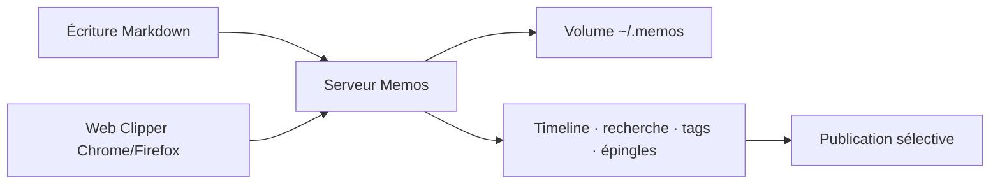

# usememos/memos

> Self-hosted notebook for short notes, in chronological Markdown.

## The problem
Quick notes end up scattered across messaging apps and files, or locked inside an all-in-one workspace that you have to structure before you can write.

## What it actually does
A chronological feed of Markdown memos: daily notes, links, work logs, snippets. You write and save without choosing a title, folder or template. Review through the feed, search, tags and pins. Each memo stays private or is published on demand. A browser extension (Chrome, Firefox) captures pages, selections and images as Markdown with the source link.

## How it is wired


## Trying it
```bash
docker run -d \
  --name memos \
  -p 5230:5230 \
  -v ~/.memos:/var/opt/memos \
  neosmemo/memos:stable
```

## Cost and gotchas
Free, MIT license, no telemetry announced. Storage lives in the mounted volume: backup is up to you.

## What it is not
Not an all-in-one workspace: no databases or project management. Organization is deliberately light — no folder tree. Installation options other than Docker are deferred to the deployment guide.

## Alternatives
No alternative named in the README.

## For you
Adopt it if you want a self-hosted work journal in one command, searchable and with no cloud dependency.
