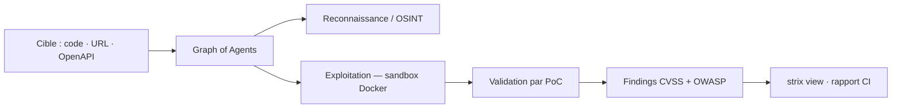

# usestrix/strix

> Autonomous, on-premise application penetration testing agents, using Docker.

## The problem
A manual penetration test can take weeks; static analysis overwhelms the team with false positives, without providing any evidence of exploitable vulnerabilities.

## What it actually does
Agents execute code dynamically, identify vulnerabilities, and validate them with real-proof-of-concept demonstrations. Embedded tools: HTTP interception proxy (Caido), automated browser, shell, Python exploit runtime in a sandbox, reconnaissance/OSINT, SAST + DAST, knowledge base with CVSS score and OWASP classification. Multi-agent orchestration for reconnaissance, exploitation, and post-exploitation. Targets: local directory, GitHub repository, URL, or OpenAPI/Postman contract. Headless mode for CI, with a non-zero exit code in case of a vulnerability.

## How it is wired


## Trying it
```bash
curl -sSL https://strix.ai/install | bash
export STRIX_LLM="openrouter/z-ai/glm-5.3"
export LLM_API_KEY="your-api-key"
strix --target ./app-directory
strix view
```

## Cost and gotchas
Docker must be running; the first run pulls the image from the sandbox. The LLM usage is your responsibility, unless you opt for the ChatGPT subscription (`strix auth login chatgpt`) or a managed cloud service. `strix view` listens on `127.0.0.1` and prints a link containing an access token for the run: do not share this lightly.

## What it is not
This is not a static scanner, and it cannot be used on a target that does not belong to you without authorization. SSO, compliance reports (SOC 2, ISO 27001, PCI DSS), and VPC deployment are reserved for business offerings.

## Alternatives
No alternative is specified in the README file.

## For you
Things to watch out for: Useful for thoroughly examining your own applications in CI, provided there is a written authorization framework in place.
