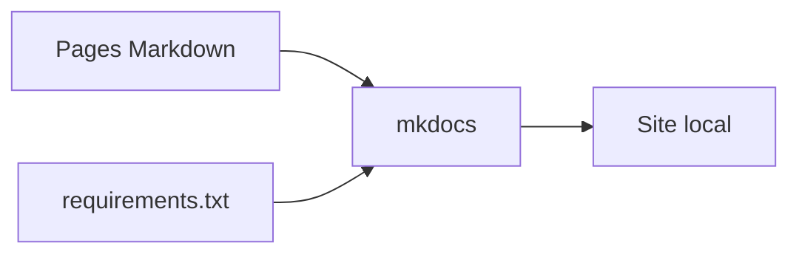

# ustclug/Linux101-docs

> Sources of the "Linux 101" introductory Linux course, in Chinese, built with MkDocs.

## The problem
Beginners at a Chinese university need an open, maintainable Linux course resource.

## What it actually does
The README only describes the build: a virtual environment, installing dependencies, then `mkdocs serve`. The course content is not detailed in the sheet provided. CC-BY-SA-4.0 license.

## How it is wired
Simplified diagram based on the sheet, no diagram provided.



## Trying it
```bash
python3 -m venv venv
. venv/bin/activate
pip install -r requirements.txt
mkdocs serve
```

## Cost and gotchas
Free. The content is in Chinese, and the CC-BY-SA license requires share-alike on reuse.

## What it is not
Not a software tool: it is course material. The README is too short to judge coverage.

## Alternatives
Linux 201, cited in the README's friend links, for the next part of the curriculum.

## For you
Ignore: introductory course in Chinese, unrelated to a data or MLOps profile already comfortable with Linux.
