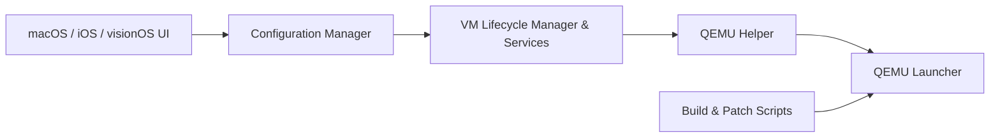

# utmapp/UTM

> Emulation and virtual machine application for macOS and iOS, built on QEMU.

## The problem
Running Windows or Linux on a Mac, an iPhone or an iPad, including with processors of a different architecture.

## What it actually does
- Full system emulation through QEMU, more than 30 processors (x86_64, ARM64, RISC-V).
- On macOS: accelerated virtualization (Hypervisor.framework) and macOS guests through Virtualization.framework (macOS 12+).
- On iOS: JIT requires a jailbroken device or a workaround; the UTM SE variant uses a threaded interpreter, which is slower, and can be installed without JIT.
- A user interface written for Apple platforms, control through `utmctl`, and remote management according to the architecture.

## How it is wired

## Trying it
The README gives no command: installation via https://getutm.app/install/ (iOS) and https://mac.getutm.app/ (macOS).

## Cost and gotchas
Free according to the README. Emulation without JIT is noticeably slower. On iOS, installation requires sideloading. 1,124 open issues in the catalog.

## What it is not
It is not a hypervisor for Linux or Windows, nor a security tool in itself. The repository classified as dual-use is here only a general-purpose emulator.

## Alternatives
- iSH: user-mode Linux terminal on iOS.
- a-shell: native Unix commands on iOS.

## For you
Ignore unless you work on a Mac: useful for testing a Linux or another architecture locally, but nothing specific to data / AI / MLOps, and no GPU for training.
