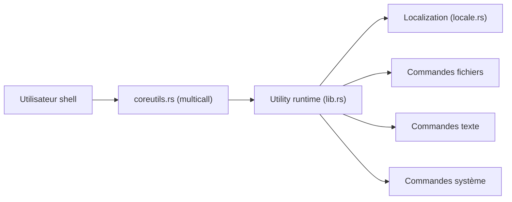

# uutils/coreutils

> Cross-platform Rust reimplementation of the GNU coreutils, aiming to be a drop-in replacement.

## The problem
Have the same `ls`, `cp`, `cat`… on Linux, macOS, Windows and WASI, with better error messages.

## What it actually does
All the programs are implemented, but some options are missing or differ. Goal: output and exit code identical to GNU, readable errors, UTF-8 internationalization, performance. A `coreutils` multicall binary or separate binaries, built with Cargo or Make. Shipped by default on Ubuntu since 25.10. Its tests follow the GNU suite.

## How it is wired


## Trying it
```bash
git clone https://github.com/uutils/coreutils
cd coreutils
cargo build --release
```

## Cost and gotchas
Free. Differences from GNU remain (1,284 open issues): test before replacing in production.

## What it is not
Not a perfect GNU clone today: "differences are bugs" according to the README.

## Alternatives
No alternative named in the README (implicit comparison with GNU coreutils).

## For you
Useful for portable scripts and for testing environments; watch its maturity before replacing anything in CI.
