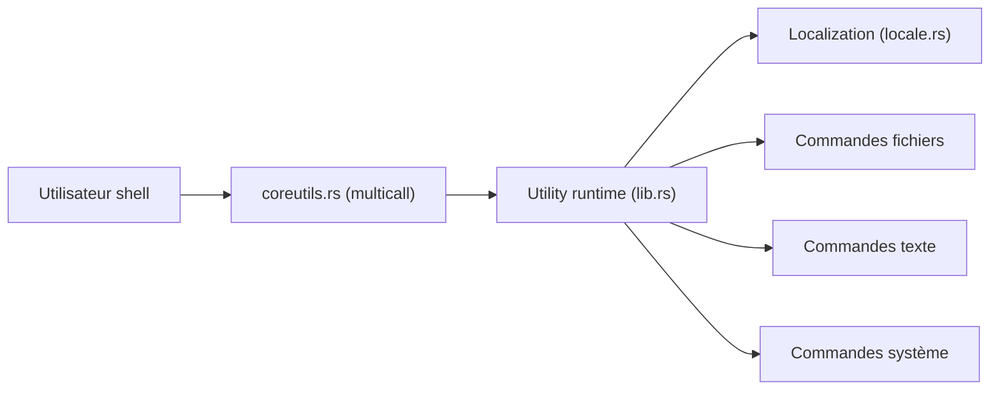

# uutils/coreutils

> Réimplémentation multiplateforme en Rust des coreutils GNU, visant le remplacement direct.

## Le problème
Avoir les mêmes `ls`, `cp`, `cat`… sur Linux, macOS, Windows et WASI, avec de meilleurs messages d'erreur.

## Ce que ça fait vraiment
Tous les programmes sont implémentés, mais certaines options manquent ou diffèrent. Objectif : sortie et code de retour identiques à GNU, erreurs lisibles, internationalisation UTF-8, performances. Un binaire multicall `coreutils` ou des binaires séparés, construits avec Cargo ou Make. Livré par défaut sur Ubuntu depuis la 25.10. Ses tests suivent la suite GNU.

## Comment c'est branché


## Essayer
```bash
git clone https://github.com/uutils/coreutils
cd coreutils
cargo build --release
```

## Coût et pièges
Gratuit. Des écarts avec GNU subsistent (1 284 issues ouvertes) : à tester avant de remplacer en production.

## Ce que ce n'est pas
Pas un clone parfait de GNU aujourd'hui : « les différences sont des bugs » selon le README.

## Alternatives
Aucune alternative nommée dans le README (comparaison implicite avec GNU coreutils).

## Pour toi
Utile pour des scripts portables et pour tester des environnements ; surveille sa maturité avant un remplacement en CI.

