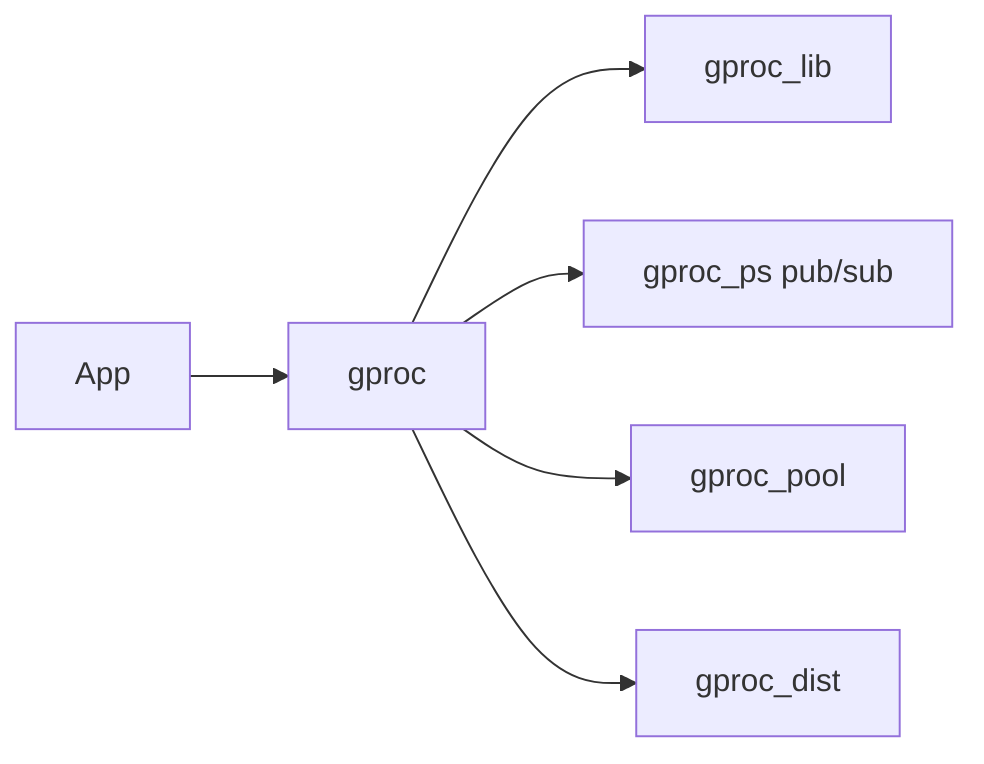

# uwiger/gproc

> Extended Erlang process registry: aliases, properties, counters and pub/sub, local or distributed.

## The problem
Erlang's native process dictionary is too limited for finding and describing processes.

## What it actually does
Aliases with any term, multiple registration, non-unique properties, aggregated counters, waiting for registration, atomic name transfer. QLC interface and match specs. Global registry across a network of nodes (optional `gen_leader` dependency). Used for system inspection and pub/sub.

## How it is wired


## Trying it
```erlang
gproc:reg({p, l, {?MODULE, EventType}}).
gproc:send({p, l, Key}, {self(), Key, Msg}).
```
```bash
export GPROC_DIST=true
```

## Cost and gotchas
Free. QuickCheck tests require a commercial EQC license (skipped without it). Dependencies `gen_leader`, `edown` are not fetched by default.

## What it is not
Not a database: an in-memory process registry.

## Alternatives
The README names no alternative.

## For you
Ignore: Erlang library, outside the data/AI stack.
