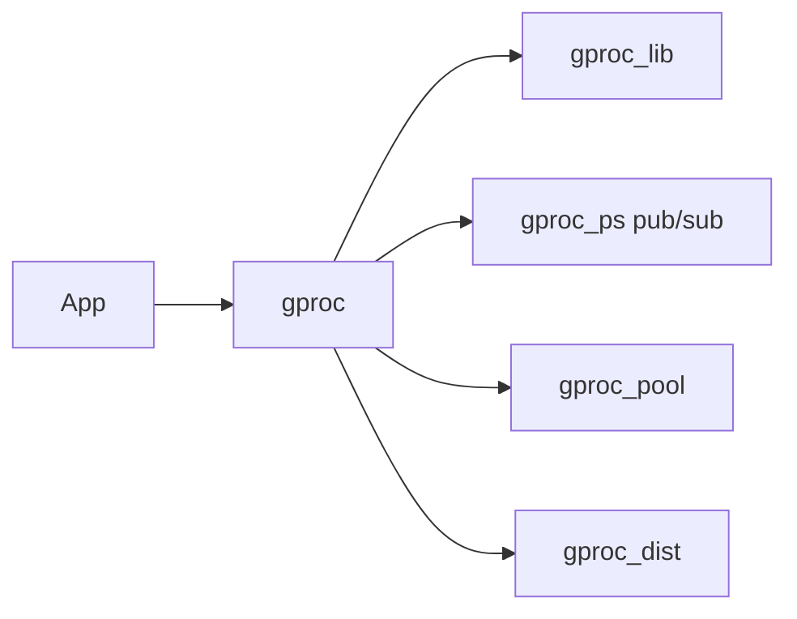

# uwiger/gproc

> Registre de processus Erlang étendu : alias, propriétés, compteurs et pub/sub, local ou distribué.

## Le problème
Le dictionnaire de processus natif d'Erlang est trop limité pour retrouver et décrire des processus.

## Ce que ça fait vraiment
Alias avec n'importe quel terme, enregistrement multiple, propriétés non uniques, compteurs agrégés, attente d'enregistrement, transfert atomique de noms. Interface QLC et match specs. Registre global sur un réseau de nœuds (dépendance optionnelle `gen_leader`). Sert à l'inspection système et au pub/sub.

## Comment c'est branché


## Essayer
```erlang
gproc:reg({p, l, {?MODULE, EventType}}).
gproc:send({p, l, Key}, {self(), Key, Msg}).
```
```bash
export GPROC_DIST=true
```

## Coût et pièges
Gratuit. Tests QuickCheck exigent une licence EQC commerciale (ignorée sans elle). Dépendances `gen_leader`, `edown` non récupérées par défaut.

## Ce que ce n'est pas
Pas une base de données : un registre de processus en mémoire.

## Alternatives
Le README ne nomme pas d'alternative.

## Pour toi
À ignorer : bibliothèque Erlang, hors stack data/IA.

