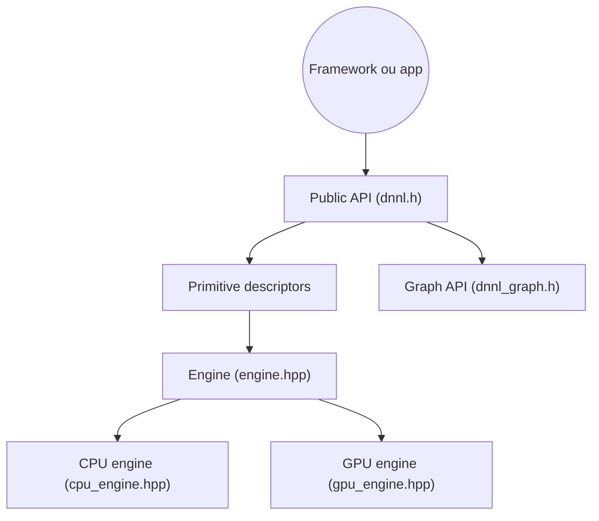

# uxlfoundation/oneDNN

> Library of deep learning operations optimized for CPU and GPU, used by AI frameworks.

## The problem
Deep learning operations (matmul, convolution, attention) must run fast on each processor, which frameworks do not want to rewrite.

## What it actually does
Provides optimized primitives, with JIT kernel generation according to the instruction set detected at runtime. Handles low-precision types (bf16, f16, f8, s8, s4) and operation fusion, including attention via the Graph API. Targets Intel, AArch64 and RISC-V; NVIDIA, AMD, PPC64 and s390x are experimental.

## How it is wired


## Trying it
```bash
conda install -c conda-forge onednn
wget https://raw.githubusercontent.com/uxlfoundation/oneDNN/main/examples/matmul_perf.cpp \
     https://raw.githubusercontent.com/uxlfoundation/oneDNN/main/examples/example_utils.hpp
g++ matmul_perf.cpp -I$CONDA_PREFIX/include -L$CONDA_PREFIX/lib \
    -ldnnl -o matmul_perf
LD_LIBRARY_PATH=$CONDA_PREFIX/lib ./matmul_perf cpu
```

## Cost and gotchas
Free. GPU support requires the DPC++ compiler and specific drivers; GPU timeouts (hangcheck, TDR) can reset the GPU.

## What it is not
It is not a training framework: the README recommends using PyTorch, TensorFlow, ONNX Runtime or OpenVINO rather than oneDNN directly. NVIDIA and AMD remain experimental.

## Alternatives
- PyTorch, TensorFlow, ONNX Runtime, OpenVINO: preferable for everyday use, they already embed oneDNN.

## For you
Worth watching: you already benefit from it via PyTorch or ONNX Runtime, and you only call it directly to write an inference engine.
