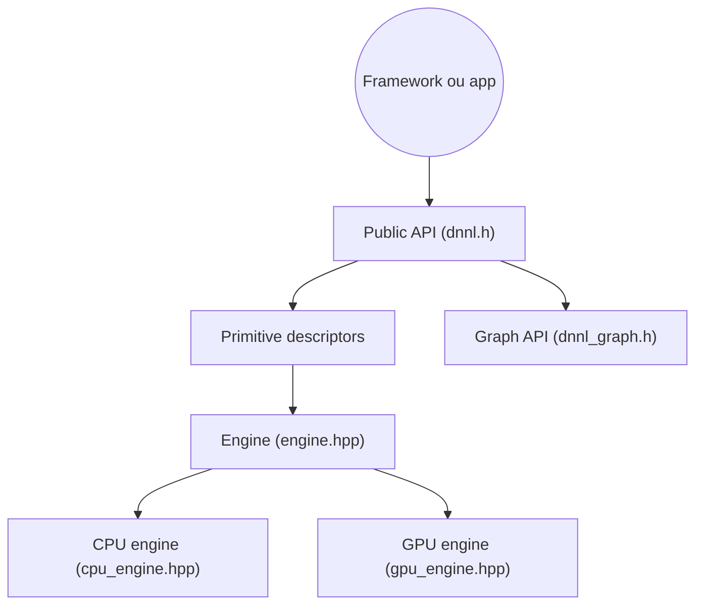

# uxlfoundation/oneDNN

> Bibliothèque d'opérations de deep learning optimisées pour CPU et GPU, utilisée par les frameworks IA.

## Le problème
Les opérations de deep learning (matmul, convolution, attention) doivent tourner vite sur chaque processeur, ce que les frameworks ne veulent pas réécrire.

## Ce que ça fait vraiment
Fournit des primitives optimisées, avec génération JIT de noyaux selon le jeu d'instructions détecté à l'exécution. Gère des types de basse précision (bf16, f16, f8, s8, s4) et la fusion d'opérations, dont l'attention via la Graph API. Cible Intel, AArch64 et RISC-V ; NVIDIA, AMD, PPC64 et s390x sont expérimentaux.

## Comment c'est branché


## Essayer
```bash
conda install -c conda-forge onednn
wget https://raw.githubusercontent.com/uxlfoundation/oneDNN/main/examples/matmul_perf.cpp \
     https://raw.githubusercontent.com/uxlfoundation/oneDNN/main/examples/example_utils.hpp
g++ matmul_perf.cpp -I$CONDA_PREFIX/include -L$CONDA_PREFIX/lib \
    -ldnnl -o matmul_perf
LD_LIBRARY_PATH=$CONDA_PREFIX/lib ./matmul_perf cpu
```

## Coût et pièges
Gratuit. Le support GPU demande le compilateur DPC++ et des pilotes spécifiques ; les timeouts GPU (hangcheck, TDR) peuvent réinitialiser le GPU.

## Ce que ce n'est pas
Ce n'est pas un framework d'entraînement : le README recommande d'utiliser PyTorch, TensorFlow, ONNX Runtime ou OpenVINO plutôt que oneDNN directement. NVIDIA et AMD restent expérimentaux.

## Alternatives
- PyTorch, TensorFlow, ONNX Runtime, OpenVINO : préférables pour l'usage courant, ils embarquent déjà oneDNN.

## Pour toi
À surveiller : tu en profites déjà via PyTorch ou ONNX Runtime, et tu ne l'appelles directement que pour écrire un moteur d'inférence.

