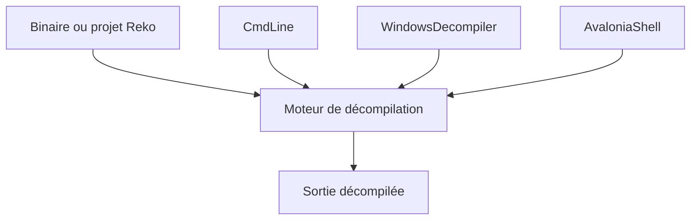

# uxmal/reko

> General-purpose decompiler for machine-code binaries, for those entitled to analyze them.

## The problem
Understanding a binary whose sources are gone forces you to read raw disassembly.

## What it actually does
A decompilation engine takes an executable or a Reko project file and analyzes it. Interfaces: command line, Windows GUI, and a cross-platform Avalonia GUI under development. Targets many processor architectures.

## How it is wired
Simplified diagram based on the sheet, no diagram provided.


## Trying it
```cmd
dotnet msbuild -p:Platform={platform} -p:Configuration={config} -v:m -t:build_solution -m ./src/BuildTargets/BuildTargets.csproj
```
The README requires the .NET 9.0 SDK.

## Cost and gotchas
Free. Requires .NET 9.0: not listed, hence `none`. Many licenses forbid decompilation: use is permitted only on your own binaries.

## What it is not
Not a perfect decompiler: the outputs need human work. Not an AI tool.

## Alternatives
No alternative named in the README.

## For you
Ignore: binary reverse engineering is not part of ordinary data / AI / MLOps work.
