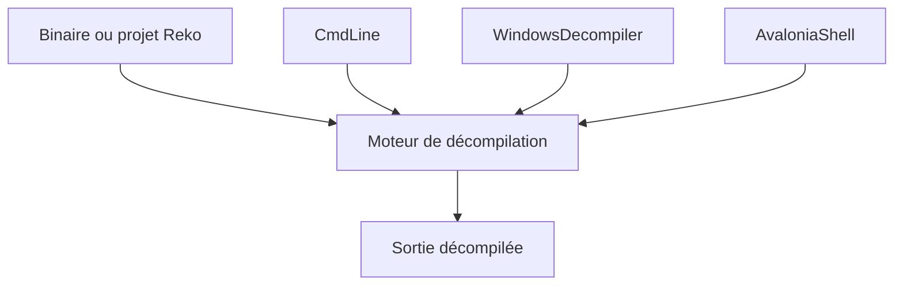

# uxmal/reko

> Décompilateur généraliste pour binaires en code machine, pour qui a le droit de les analyser.

## Le problème
Comprendre un binaire dont on n'a plus les sources oblige à lire du désassemblage brut.

## Ce que ça fait vraiment
Un moteur de décompilation reçoit un exécutable ou un fichier de projet Reko et l'analyse. Interfaces : ligne de commande, GUI Windows, GUI Avalonia multiplateforme en cours de développement. Vise de nombreuses architectures de processeur.

## Comment c'est branché
Schéma simplifié d'après la fiche, sans diagramme fourni.


## Essayer
```cmd
dotnet msbuild -p:Platform={platform} -p:Configuration={config} -v:m -t:build_solution -m ./src/BuildTargets/BuildTargets.csproj
```
Le README demande .NET 9.0 SDK.

## Coût et pièges
Gratuit. Requiert .NET 9.0 : non listé, d'où `aucun`. Beaucoup de licences interdisent la décompilation : usage permis seulement sur ses propres binaires.

## Ce que ce n'est pas
Pas un décompileur parfait : les sorties demandent du travail humain. Pas un outil d'IA.

## Alternatives
Aucune alternative nommée dans le README.

## Pour toi
Ignorer : la rétro-ingénierie de binaires n'entre pas dans un travail data / IA / MLOps courant.

