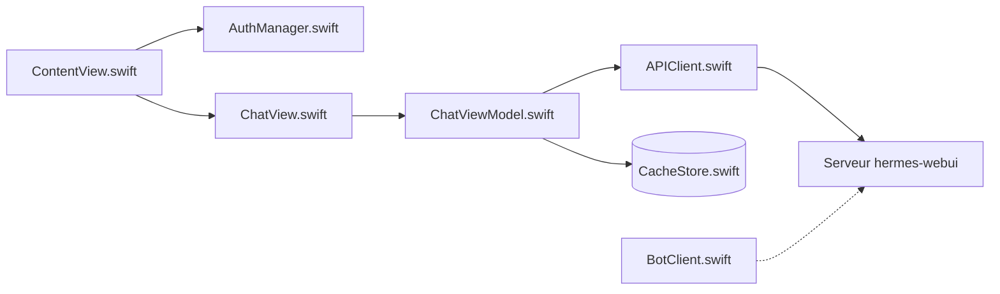

# uzairansaruzi/hermex

> Native iPhone app to control a self-hosted Hermes agent from your phone.

## The problem
An agent running on your machine can only be used from a browser or a terminal; following or restarting it from a mobile is painful.

## What it actually does
SwiftUI client (iOS 18+) for an hermes-webui server: chat with a choice of model, reasoning effort, workspace and profile; attachments; streaming with reasoning and tool calls.
Stop or redirect a run in progress; sessions readable offline through a local cache.
Cron tasks, skills, file explorer and Git view of the server, memory and statistics in read-only mode.
Bot mode: direct connection to hermes-agent. Optional push through an open-source, self-hostable relay.

## How it is wired


## Trying it
```bash
xcodebuild -project HermesMobile.xcodeproj -scheme HermesMobile -destination 'platform=iOS Simulator,name=iPhone 17' build
xcodebuild test -project HermesMobile.xcodeproj -scheme HermesMobile -destination 'platform=iOS Simulator,name=iPhone 17'
xcrun simctl list devices available
tailscale serve --bg 8787
```

## Cost and gotchas
Free, no in-app purchases. You need your own hermes-webui server (Python 3.11+) exposed over HTTPS (Cloudflare Tunnel, reverse proxy or Tailscale Serve); securing and maintaining it is up to you. Build: Xcode 26.

## What it is not
Not an agent: no backend is provided, the phone only controls.
Not guaranteed compatible: the upstream API is not stable, and the app is tested against a specific commit (`UPSTREAM_TESTED_SHA`).
iPhone only.

## Alternatives
No alternative named in the README.

## For you
Ignore, unless you already run Hermes at home.
