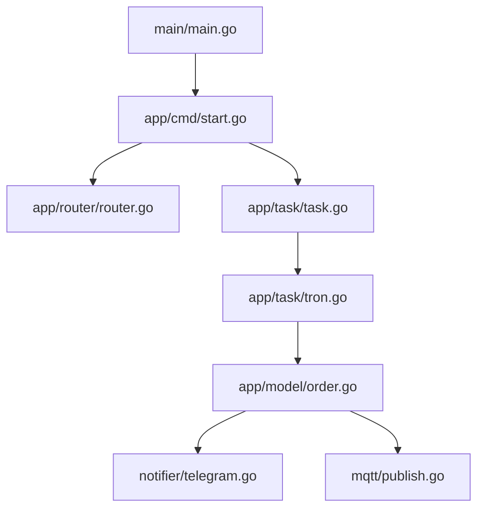

# v03413/BEpusdt

> Self-hosted cryptocurrency payment gateway, to accept USDT payments on several blockchains.

## The problem
Accepting cryptocurrency on a website requires watching blocks and matching each payment to an order.

## What it actually does
A Go binary launches an HTTP router (Epusdt API, Epay, administration) and tasks that scan Tron, EVM and Solana blocks. A detected payment updates the order, then triggers a Telegram notification and an MQTT message. The administration interface is a Vue application. The README is in Chinese and states that it offers no paid service.

## How it is wired


## Trying it
```bash
docker run -d --restart=unless-stopped -p 8080:8080 v03413/bepusdt:latest
```

## Cost and gotchas
Free (GPL-3.0). It needs stable blockchain RPC nodes, a domain, HTTPS and wallet management: any error affects real money.

## What it is not
It is not a regulated financial product or a managed service: the author disclaims all responsibility. It has no link with the original Epusdt project.

## Alternatives
No alternative named in the README (it cites Epusdt as its origin).

## For you
Ignore: a crypto payment gateway is outside the data, AI and MLOps scope, and using it carries financial responsibility.
