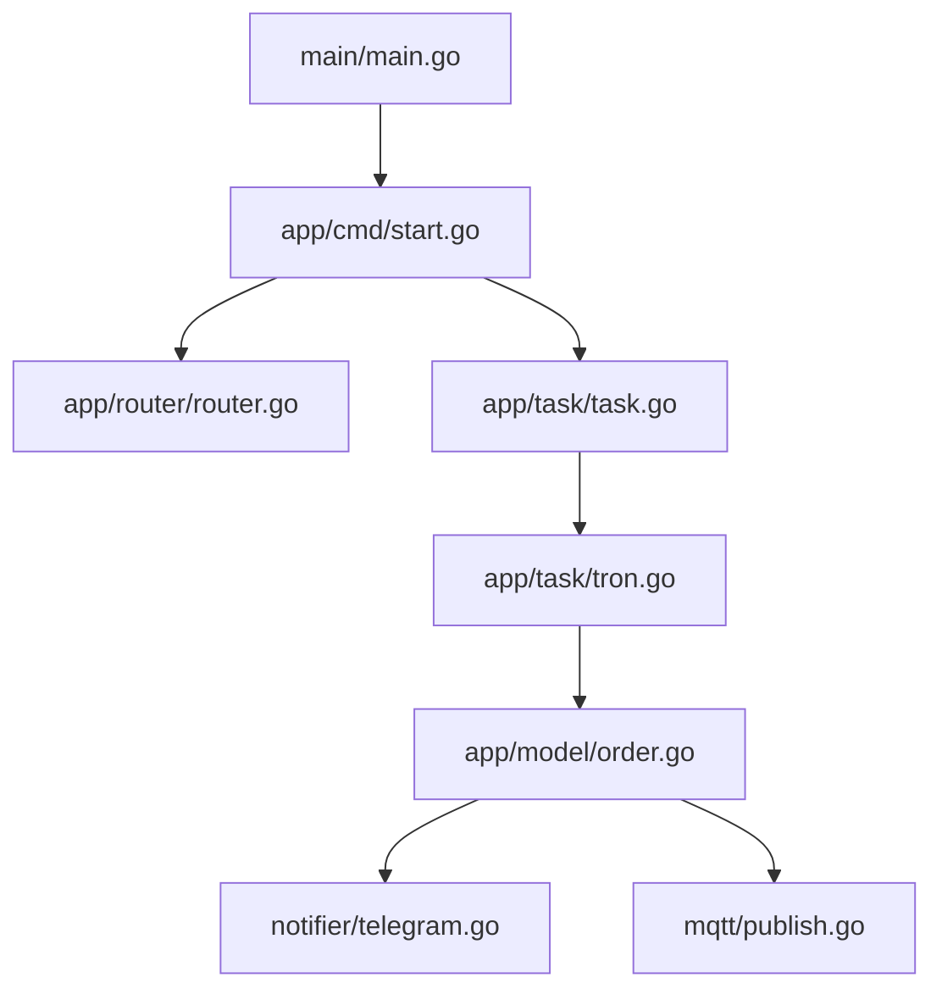

# v03413/BEpusdt

> Passerelle de paiement en cryptomonnaie auto-hébergée, pour encaisser en USDT sur plusieurs blockchains.

## Le problème
Encaisser en cryptomonnaie sur un site demande de surveiller les blocs et de rapprocher chaque paiement d'une commande.

## Ce que ça fait vraiment
Un binaire Go lance un routeur HTTP (API Epusdt, Epay, administration) et des tâches qui scrutent les blocs Tron, EVM et Solana. Un paiement détecté met à jour la commande, puis déclenche une notification Telegram et un message MQTT. L'interface d'administration est une application Vue. Le README est en chinois et annonce ne proposer aucun service payant.

## Comment c'est branché


## Essayer
```bash
docker run -d --restart=unless-stopped -p 8080:8080 v03413/bepusdt:latest
```

## Coût et pièges
Gratuit (GPL-3.0). Il faut des nœuds RPC de blockchain stables, un domaine, HTTPS et une gestion de portefeuilles : toute erreur touche de l'argent réel.

## Ce que ce n'est pas
Ce n'est pas un produit financier réglementé ni un service géré : l'auteur décline toute responsabilité. Il n'a aucun lien avec le projet Epusdt d'origine.

## Alternatives
Aucune alternative nommée dans le README (il cite Epusdt comme origine).

## Pour toi
À ignorer : une passerelle de paiement crypto est hors du périmètre data, IA et MLOps, et son usage engage une responsabilité financière.

