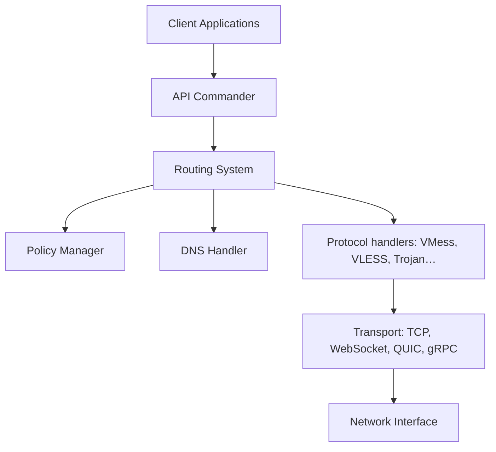

# v2fly/v2ray-core

> Modular network proxy platform (Project V), for anyone who wants to build configurable network paths.

## The problem
The provided README does not say: it contains only links and credits. Judging from the architecture, the aim is to have a proxy where protocols, transports and routing rules combine freely.

## What it actually does
Minimal sheet: README under 800 characters. Based on the architecture described from the code, the core is split into layers: transport, proxy (VMess, VLESS, Shadowsocks, Trojan, SOCKS, HTTP, Dokodemo-door), app (DNS, routing, policies, statistics) and common services. There is also multiplexing, a connection quality observatory, subscription management and control APIs (commander). The rest (installation, configuration) is not documented here.

## How it is wired


## Trying it
```bash
# Aucune commande documentée dans le README fourni.
```

## Cost and gotchas
Free software (MIT), free of charge. The README describes no prerequisite nor installation procedure: you must refer to the external documentation linked.

## What it is not
Not a turnkey product: it is a proxy engine, with no interface provided according to the README. A tool of this kind falls, depending on the country, under local legal rules on the use of proxies and encryption; the user is responsible.

## Alternatives
No alternative named in the README.

## For you
Worth watching rather than adopting: the repository is active and widely followed, but the material provided is insufficient to judge its interest in data / AI / MLOps work, where it serves only as network infrastructure.
