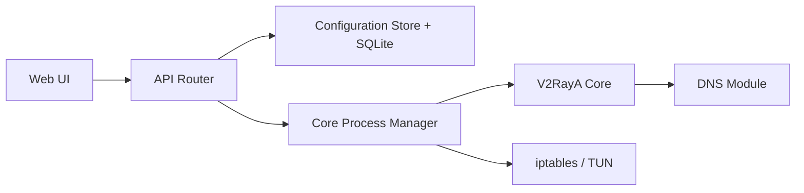

# v2rayA/v2rayA

> Web client for an Xray core, with a transparent proxy on Linux, Windows and macOS.

## The problem
Configuring a proxy core (subscriptions, routing rules, transparent proxy) on the command line is tedious.

## What it actually does
A service with a web interface: imports subscriptions and share links (VMess, VLESS, Shadowsocks, Trojan, Hysteria2, TUIC, WireGuard, SOCKS5, HTTP), groups nodes and picks the fastest, applies RoutingA rules. Transparent proxy through `redirect`, `tproxy` or `tun`. SQLite database and dedicated DNS handling.

## How it is wired


## Trying it
```bash
sudo apt install v2raya
sudo systemctl enable --now v2raya
docker run -d --restart=always --privileged --network=host --name v2raya ghcr.io/v2raya/v2raya
```

## Cost and gotchas
Listens on `0.0.0.0:2017`; the first account created becomes administrator, with no prior login: restrict access before registering. Root rights for the transparent proxy, privileged container. Network requests to GitHub, a Chinese NTP server (`ntp.aliyun.com`) and rule sources. AGPL-3.0 license.

## What it is not
It is not a proxy service provided to you: you need nodes of your own. ShadowsocksR is not supported.

## Alternatives
No alternative named in the README (the Dae Universe package repository is an installation source).

## For you
To ignore: a network tool unrelated to data, AI or MLOps, with an administration surface to secure.
