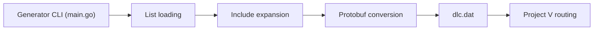

# v2ray/domain-list-community

> Domain lists by category compiled into `dlc.dat` for Project V routing rules.

## The problem
Writing domain-based routing rules (ads, services, regions) by hand in V2Ray is slow and inconsistent.

## What it actually does
Each file in the `data` folder is a list (domain, keyword, regex, full, include, `@` attributes). The Go generator loads the lists, expands the `include:` directives, converts to GeoSite records (protobuf) and writes `dlc.dat`, used in the configuration as `geosite:name`. This repository now only serves to publish `dlc.dat`; issues and PRs are handled in v2fly/domain-list-community.

## How it is wired


## Trying it
```bash
go get -u -v --insecure github.com/v2ray/domain-list-community
$(go env GOPATH)/bin/domain-list-community
$(go env GOPATH)/bin/domain-list-community --datapath=/path/to/your/custom/data/directory
```

## Cost and gotchas
Free. The repository has moved: use v2fly to contribute. The `--insecure` option of the README's `go get` should be avoided.

## What it is not
Not a blocking or circumvention tool in itself: the README says it recommends nothing about which domains to block or proxy.

## Alternatives
- v2fly/domain-list-community (cited): the repository that now receives contributions.

## For you
Ignore: useful only if you administer V2Ray routing.
