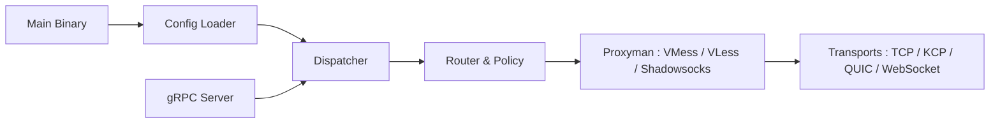

# v2ray/v2ray-core

> Old repository of a network proxy engine in Go, now moved to v2fly/v2ray-core.

## The problem
Build your own encrypted network paths, with routing and a choice of transport protocol, without going through a single solution.

## What it actually does
The very short README only says that Project V is a set of network tools that secure connections. From the code architecture: a modular engine in Go with a dispatcher, routing and policies, DNS resolver, statistics, logging, protocol modules (VMess, VLess, Shadowsocks, SOCKS, HTTP, Trojan…) and transports (TCP, UDP, KCP, QUIC, WebSocket). A gRPC control plane exists.

## How it is wired

## Trying it
No command documented in the README, which points to the project website and the v2fly repository.

## Cost and gotchas
Free. The README announces the move to v2fly: this repository is no longer the reference. Proxy and circumvention uses are regulated by each country's law.

## What it is not
Not a turnkey VPN nor a product documented here: the documentation is elsewhere. It is no longer the active repository.

## Alternatives
- v2fly/v2ray-core: the repository the project moved to.

## For you
Ignore: repository flagged as moved, unrelated to data / AI work; if the topic interests you, go straight to v2fly.
